# Diagrams, and how to make slides like them

Every diagram in these labs is built like a **customer-ready slide**: 16:9, one message, consistent colours. Use them in two ways:

1. **Reuse them.** Each one comes as an editable **SVG** and a high-resolution **PNG** (3200×1800) in [`png/`](png/).
2. **Learn from them.** The design rules below are the same ones you should use when you build your own slides for a customer.

> [!NOTE]
> For customer-facing decks, start from the **official Canonical slide template and brand assets** (ask Marketing). These diagrams follow similar principles, but they aren't official brand artwork.

---

## Gallery

| | | |
|---|---|---|
| [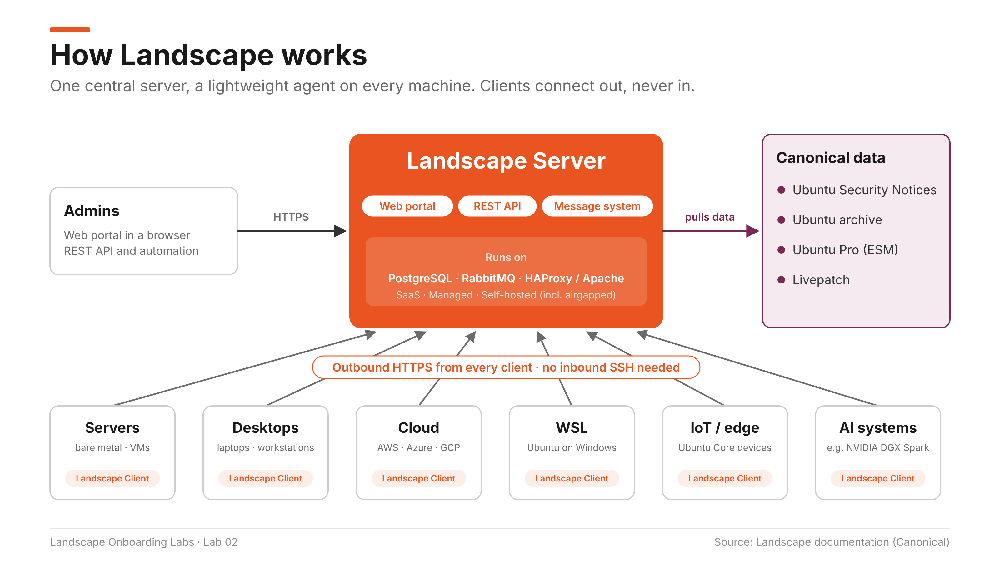](png/landscape-architecture.png) **How Landscape works** · Lab 02 | [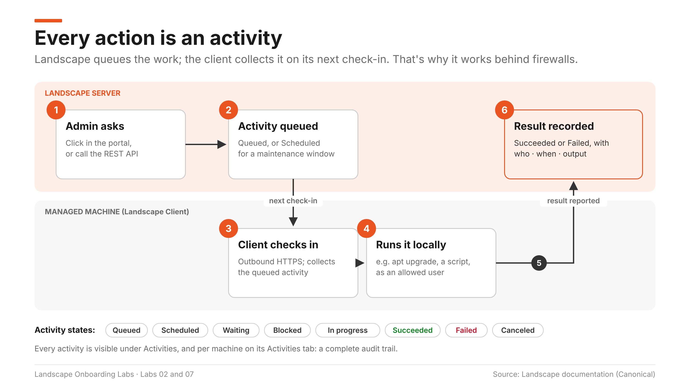](png/activity-lifecycle.png) **Every action is an activity** · Labs 02, 07 | [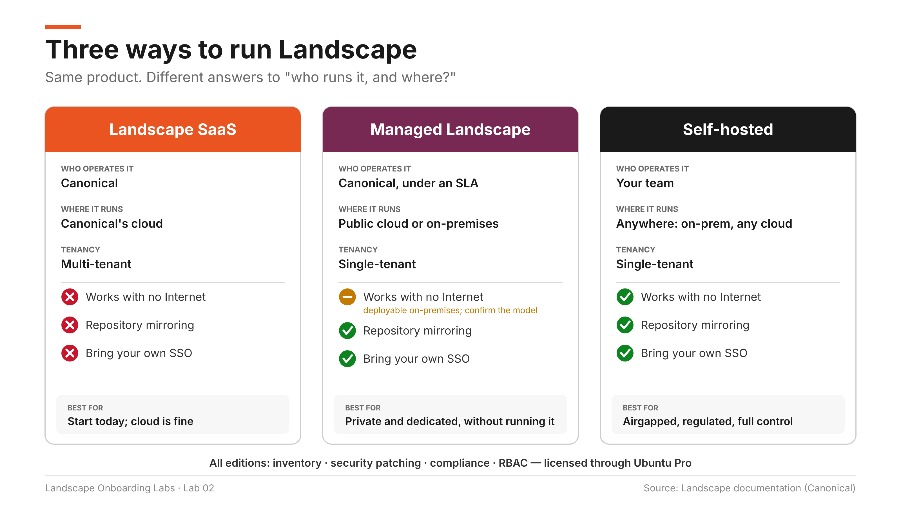](png/landscape-editions.png) **Three ways to run Landscape** · Lab 02 |
| [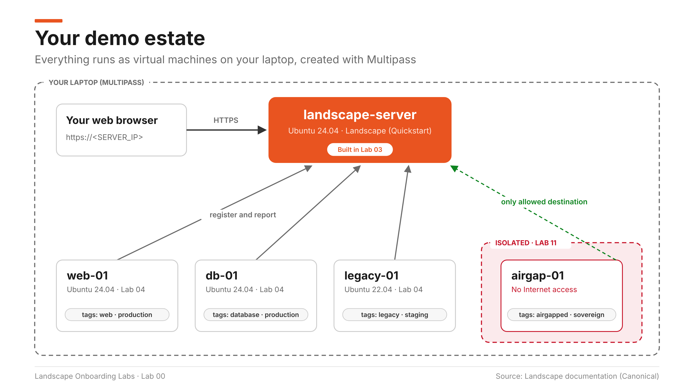](png/demo-estate.png) **Your demo estate** · Lab 00 | [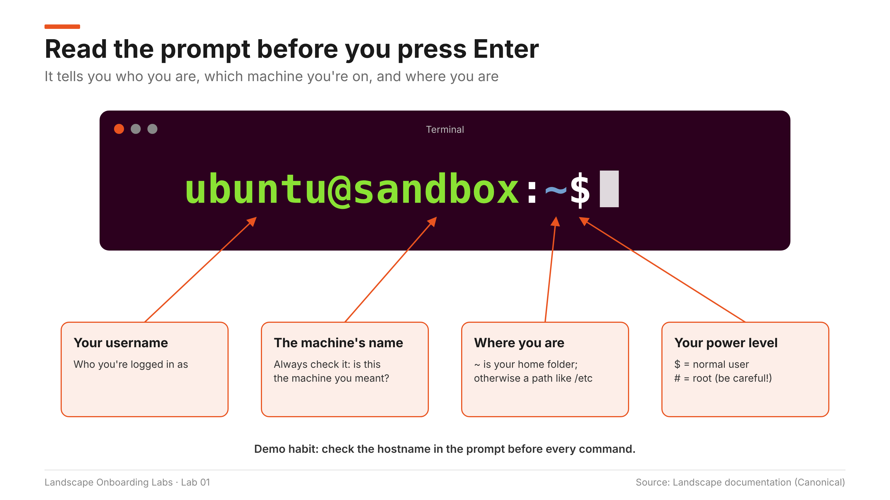](png/reading-the-prompt.png) **Read the prompt** · Lab 01 | [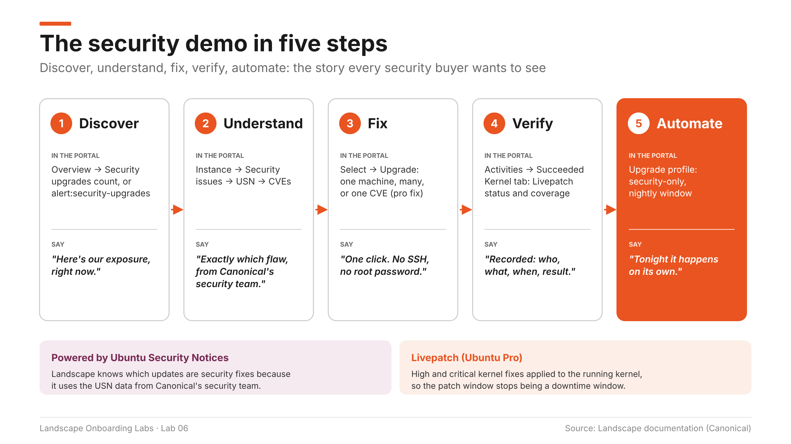](png/security-demo-flow.png) **The security demo in five steps** · Lab 06 |
| [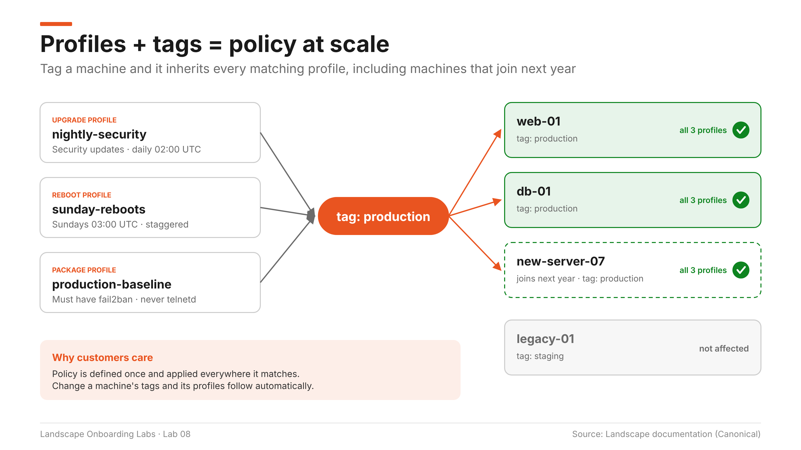](png/profiles-and-tags.png) **Profiles + tags = policy** · Lab 08 | [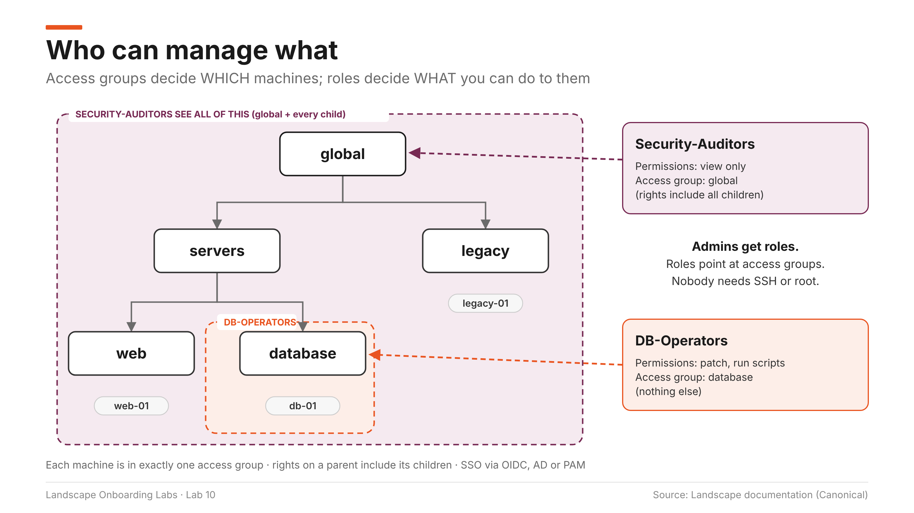](png/access-groups-and-roles.png) **Who can manage what** · Lab 10 | [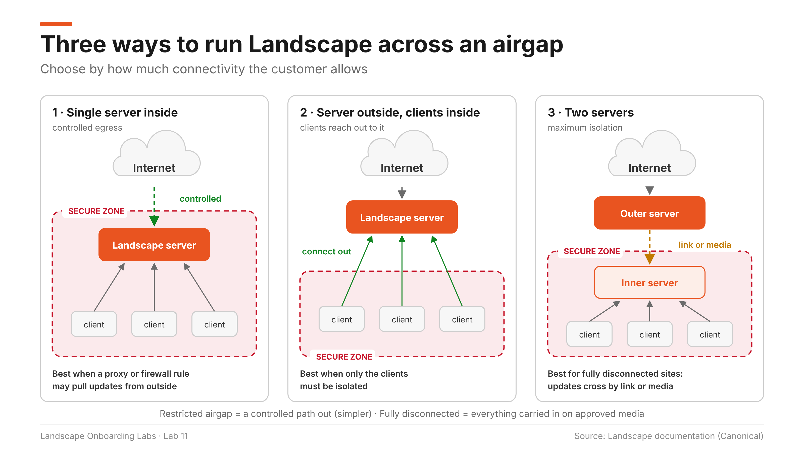](png/airgap-layouts.png) **Three airgap layouts** · Lab 11 |
| [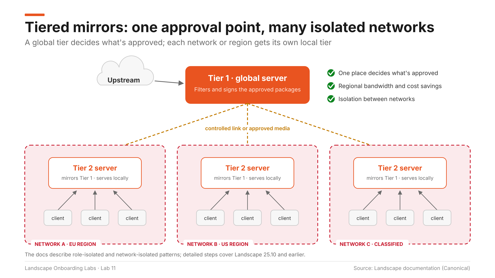](png/tiered-mirrors.png) **Tiered mirrors** · Lab 11 | [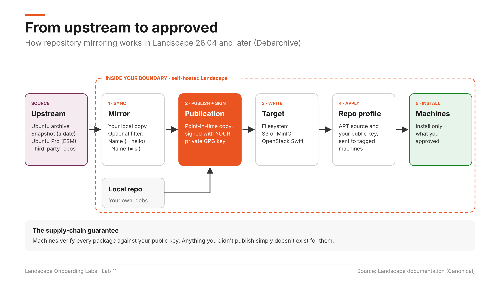](png/mirroring-pipeline.png) **From upstream to approved** · Lab 11 | [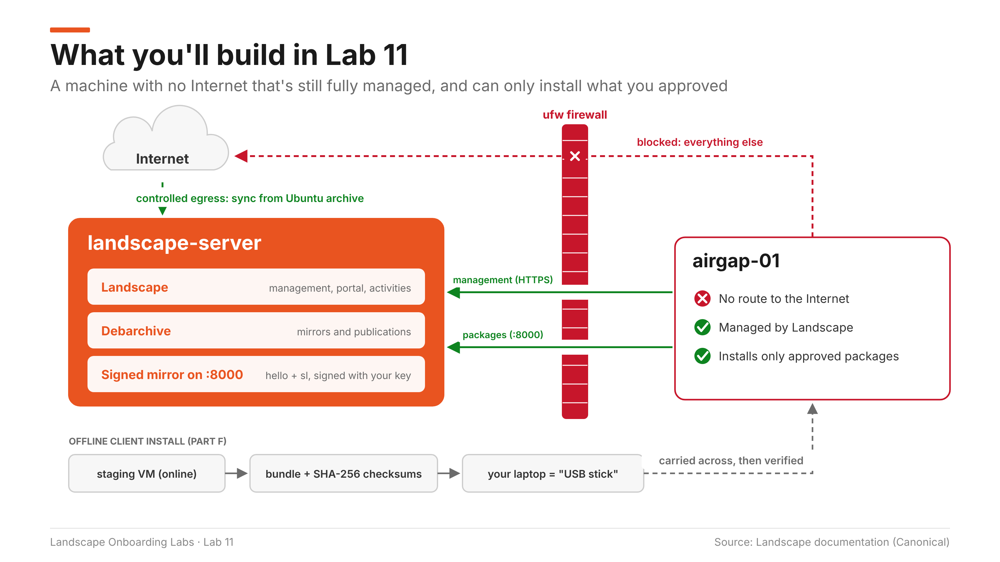](png/lab11-airgap-build.png) **What you'll build in Lab 11** · Lab 11 |

---

## The rules behind these slides

### 1. The title is the message, not the topic

| ❌ Topic title | ✅ Message title |
|---|---|
| "Activity lifecycle" | **"Every action is an activity"** |
| "Access groups" | **"Who can manage what"** |
| "Repository mirroring" | **"From upstream to approved"** |

If the customer reads only the title, they should still get the point. The **subtitle** says why it matters to *them*.

### 2. Colour means something, every time

| Colour | Hex | Meaning |
|---|---|---|
| 🟧 Orange | `#E95420` | **Landscape**, the thing we're selling and the hero of the slide |
| 🟪 Aubergine | `#772953` | Canonical services and data (USNs, Pro, Livepatch), and roles with wide scope |
| 🟩 Green | `#0E8420` | Allowed, compliant, approved |
| 🟥 Red | `#C7162B` | Boundaries, isolation, blocked, risk |
| ⬜ Greys | `#F7F7F7` · `#CDCDCD` · `#6B6B6B` | Everything else, including the customer's existing machines |

Don't use colour for decoration. If something is orange, the audience should be able to say "that's Landscape". And never rely on colour alone: pair it with an icon (✓ ✗) or a word, so the slide works for colour-blind viewers and on bad projectors.

### 3. Draw the real mechanism

Arrows point in the direction the **connection** is opened. In *How Landscape works*, the arrows go **from the clients to the server**, because clients connect out. That's the security argument ("no inbound SSH"), so the picture must prove it. Label arrows with a **verb or protocol** ("HTTPS", "sync", "publish", "blocked").

### 4. Show boundaries explicitly

For security, compliance and sovereignty conversations, the boundary **is** the story. Use a dashed zone with a label ("SECURE ZONE", "YOUR LAPTOP", "INSIDE YOUR BOUNDARY") and show what crosses it and what doesn't.

### 5. One message, at most about seven things

If a slide needs more than about seven boxes, split it or group them (*Servers · Desktops · Cloud…* are six boxes, not sixty machines). Number the steps of a sequence, and read left to right or top to bottom.

### 6. Make text readable from the back of the room

- Title ~46 px, body 17–24 px on a 1600×900 canvas (roughly 32 pt and 12–17 pt on a slide).
- Short phrases, not sentences. If you need a paragraph, it belongs in your voice, not on the slide.

### 7. Use the customer's words

Before a call, tailor the diagram to the customer: rename "Network A · EU region" to *"Frankfurt DC"*, replace "web-01" with their application names, and delete what doesn't apply. A diagram of **their** environment is far more persuasive than a generic one.

### 8. Cite your source and stay honest

Every diagram cites the official documentation in its footer. When something depends on the deal (e.g. Managed Landscape's connectivity model), the diagram says so (*"confirm the model"*) instead of drawing a promise.

---

## How to tailor and reuse them

| Tool | How |
|---|---|
| **PowerPoint** (Microsoft 365) | *Insert → Pictures* → choose the **SVG**, then right-click → **Convert to Shape** to edit text and boxes. |
| **Google Slides / Keynote** | Insert the **PNG**. To change text, edit the SVG first (below), then export a new PNG. |
| **Figma / Inkscape / Illustrator** | Open the **SVG** directly. Everything is real text and shapes, so it's fully editable. |
| **A text editor** | SVGs are plain text: search for a label (e.g. `Network A`) and change it. |

---

## ✏️ Exercise: turn a lab diagram into a customer slide (20 min)

1. Pick your answer to one of the **design-exercise scenarios** in [Lab 11, Part C](../labs/11-sovereign-airgapped-and-repos.md#part-c-airgap-architectures).
2. Start from [`airgap-layouts.svg`](airgap-layouts.svg) or [`tiered-mirrors.svg`](tiered-mirrors.svg).
3. Keep only the layout you chose, rename everything in the customer's terms, and rewrite the title as **the message** (e.g. *"Every update reaches your enclaves without touching the Internet"*).
4. Check it against rules 1–8 above, then show it to a colleague. Can they explain the slide back to you in one sentence?

---

## Contributing a diagram

Keep the same canvas (1600×900), colours, fonts and footer, and add both the SVG and a 2× PNG. Give every diagram embedded in a lab **meaningful alt text** that describes what the diagram shows, not just its title.
